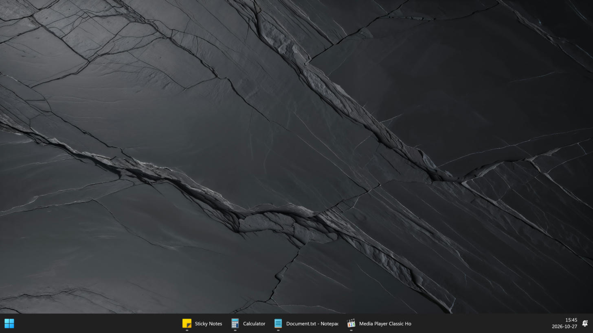
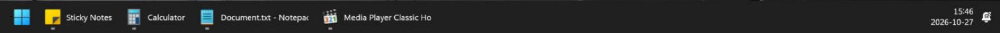
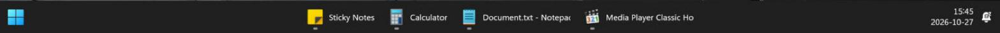
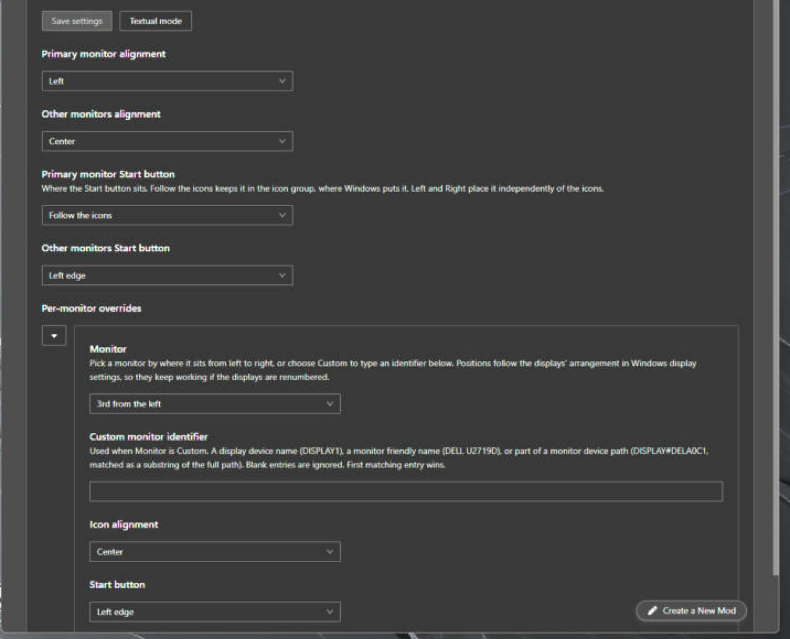

# Per-monitor taskbar icon alignment

A [Windhawk](https://windhawk.net) mod for the native **Windows 11 taskbar**. Every
monitor gets its own look:

* **Icons:** Left, Center, Right, or Windows' default.
* **Start button:** at the left edge, the right edge, or with the icons.

Windows itself offers a single alignment for all taskbars, and only Left or Center.



| Icons | Start button | Result |
| --- | --- | --- |
| Left | with the icons |  |
| Center | with the icons |  |
| Right | with the icons |  |
| Center | left edge |  |
| Left | right edge |  |

## Install

From the Windhawk catalog: search for **Per-monitor taskbar icon alignment** and
install it. To use this source directly instead, choose **Create a new mod** in
Windhawk, replace the editor contents with
[`taskbar-per-monitor-alignment.wh.cpp`](taskbar-per-monitor-alignment.wh.cpp), then
compile and enable it.

Then restart Windows Explorer **once** (Task Manager > Windows Explorer > Restart, or
sign out and back in). The mod has to be present when each taskbar is created so it
can capture that taskbar's settings; this applies after installing, enabling or
recompiling it. Settings changes afterwards apply immediately.

Enable Windows' **Show my taskbar on all displays** if secondary taskbars are absent.
Disabling the mod puts every taskbar back to Windows' own layout.

## Configure



**Primary monitor / Other monitors** set the icon alignment and the Start button
placement for every monitor of that kind. Defaults: primary Center, others Left,
Start button following the icons. *Windows default* keeps Windows' own alignment.

**Per-monitor overrides** target single displays. Add one row per monitor and pick it
from the **Monitor** dropdown: *1st* to *6th from the left*, or *Rightmost*. Windhawk's
settings can only show a fixed list, so it can't list the displays it detects;
positions follow the arrangement in Windows display settings, which makes them keep
working when displays are renumbered or reconnected. Choose *Custom* to type an
identifier instead, any one of:

| Identifier | Example | Matching | Stability |
| --- | --- | --- | --- |
| Display device name | `DISPLAY2` or `\\.\DISPLAY2` | whole value | changes when displays or graphics hardware are reconfigured |
| Monitor friendly name | `DELL U2719D` | whole value | per model, so identical monitors are indistinguishable |
| Monitor device path | `DISPLAY#DELA0C1` | substring of the full path, for any value containing `#` | encodes the hardware id and connector, so it survives reconnection |

Matching ignores case and surrounding spaces, the first matching row wins, and up to
256 rows are read. A row's icon alignment of *Windows default* keeps Windows'
alignment rather than the primary/other default. `list-monitors.ps1` prints the
device name, friendly name and device path of every active display.

**Start button.** *Follow the icons* (the default) leaves it in the icon group, where
Windows puts it. *Left edge* and *Right edge (next to the tray)* take its slot out of
the group, so the icons close the gap, and place it independently. Choosing the edge
the icons already gather at changes nothing. There is deliberately no center option.

**Right** is this mod's own option. Windows' alignment setting has only Left and
Center, so a Right taskbar is told Left and its icon area is aligned right in the
taskbar's layout, with the tray's width reserved so the icons stop at the tray. The
tray itself never moves.

## Compatibility and limits

Windows 11, x64, native taskbar. Developed and tested on Windows 11 26H2 (build
26300) with Windhawk 1.7.3, on three displays with different resolutions and scales.
Not supported: Windows 10, ARM64, vertical taskbars, and tools that replace the
taskbar or change its alignment or layout (ExplorerPatcher, StartAllBack, Start11's
taskbar features and other Windhawk taskbar-layout mods). Start menu and search
flyouts keep using Windows' own placement. No registry values are changed, and the mod
doesn't poll, inject input or restart Explorer.

Not yet checked: unplugging or reconnecting a monitor while running, many pinned apps
on a Right taskbar, and auto-hide.

The mod depends on private `taskbar.dll` symbols and XAML element names, so a Windows
update can break it. If the core hooks can't be found, the mod refuses to start. The
XAML-based features (Right icons, Start button placement) are optional: if their
symbols or elements are missing they stay off and Left/Center still work.

## How it works

The mod hooks `TaskbarSettings`' constructor, destructor and both alignment getters in
`taskbar.dll`. The constructor's `ITaskListWndSite` supplies the taskbar's window, whose
monitor is looked up again on every read, so moving a taskbar or changing the primary
display is handled. The COM interface is located by matching its symbol-resolved
vtable, and the XAML-based features reach the taskbar through
`ITaskListWndSite::GetTaskbarHost` and `TaskbarHost::FrameHeight`, whose first
instructions yield the element offset at runtime rather than it being hard-coded.

Right icons set the horizontal alignment and right margin of `TaskbarFrameRepeater`.
The Start button (`Taskbar.ExperienceToggleButton`, automation id `StartButton`) gets a
negative right margin equal to its width, which removes its slot from the icon group,
and a render transform, which doesn't affect layout, moves it to its edge. Positions
are recomputed on every layout pass, writing a property only when its value changes.
All XAML access happens on the taskbar's own thread, retried while the taskbar is
still being built, and everything is restored when the mod is disabled.

Windhawk finds a mod's entry points by their C++-mangled names, so `Wh_ModInit`,
`Wh_ModSettingsChanged` and `Wh_ModBeforeUninit` must be plain functions. Declaring them
`extern "C"` exports different names, the engine never calls init, and the mod loads
but silently does nothing.

## Build and test

```powershell
.\build.ps1
# Nonstandard Windhawk location:
.\build.ps1 -WindhawkPath 'D:\Windhawk'
```

The script compiles the mod and `tests.cpp` with Windhawk's own compiler, headers and
import library, then runs the tests. They cover defaults, name and path
normalization, identifier and position matching (including the near misses that must
not match), rule precedence, Start button placement, the layout request packing, the
interface vtable lookup, the fallbacks for untracked taskbars and invalid windows, and
a live display-configuration lookup. They can't exercise Explorer itself; the layout
behaviour was verified by hand on a running desktop. The DLL in `build` is a
compilation artifact: install through Windhawk's source editor so it handles
metadata, settings, hooks and dependencies.

## License

MIT, see [LICENSE](LICENSE).
